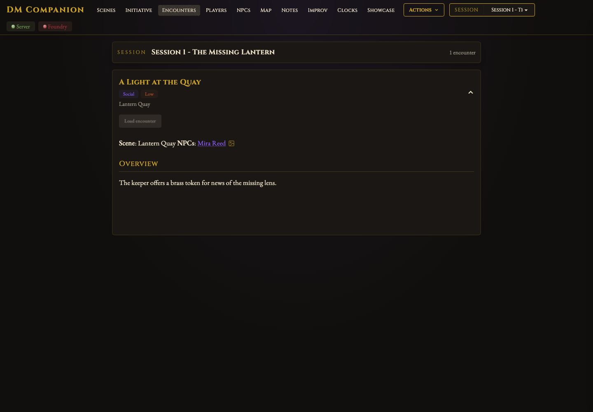
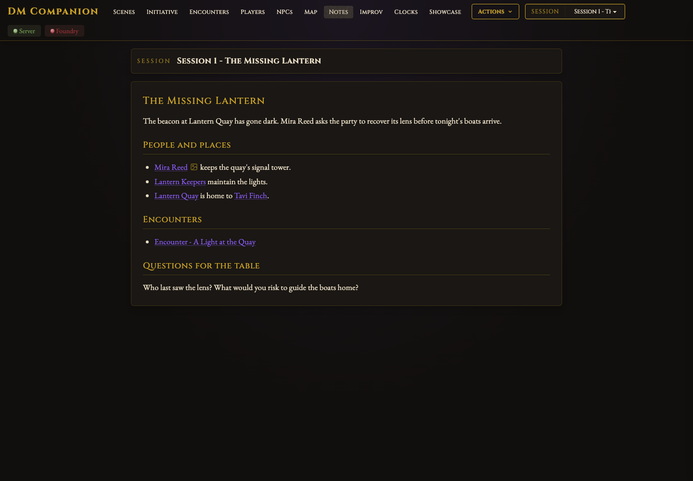
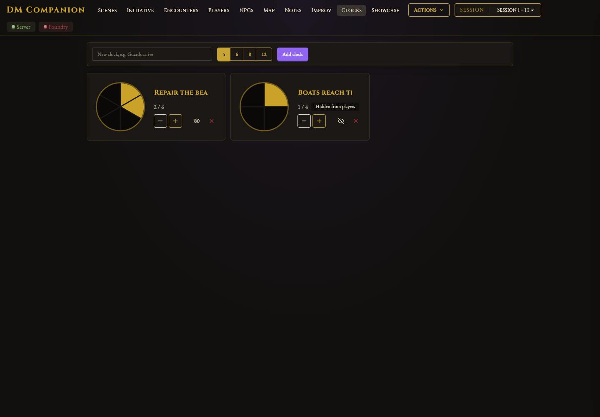

# DM Companion user guide

DM Companion is a local GM dashboard, not a replacement for Foundry. The browser
UI talks to a Python server; the bridge in the GM's Foundry browser executes
Foundry actions. Players do not need to open the companion.

Start with [installation and vault configuration](../README.md#install).
Use one GM connection and a local Foundry browser at `localhost` or `127.0.0.1`.
Hosted Foundry, multiple simultaneous worlds, and remote access are not supported.

## First session

1. Start the Python companion, then open `http://localhost:4000`.
2. Open your Foundry world as GM and enable **DM Companion Bridge**. Check the
   companion's connection indicator. Reload Foundry after changing module files.
3. If using notes, configure the vault and restart the companion. Select a
   session in the upper-right picker; it is shared by Encounters, Notes, and Map.
4. Visit Scenes and activate a scene. Check Foundry before continuing.
5. Read the encounter, then use **Load encounter** when ready. This changes the
   active scene and adds portraits, but does not start combat or place tokens.

Without a vault, Foundry controls, clocks, and showcase still work. Without
Foundry, you can read notes, browse the map, roll improv tables, and edit clocks.
Foundry-only actions are unavailable until the bridge connects.

## Navigation and common controls

The top navigation selects a view. Search filters the current view where
supported; in Showcase it searches available characters and NPCs. The Actions
menu can refresh Foundry state, add selected tokens to combat, pause/unpause,
open Foundry, and clear displayed artwork. Search text and the session picker
are different filters.

The selected view and session are remembered in this browser's local storage.
They are not a server backup and may differ in another browser.

## Scenes

Browse scene cards and folders, search by name, and click a scene to activate it
for the world. Star commonly used scenes to keep them in Favorites. Favorites
are saved per world. Activation affects your players; it is not a private preview.
Use Refresh from Foundry after making changes that have not appeared yet.

## Initiative

Add selected Foundry tokens through Actions, use Party quick-add, or use the
swords button on an NPC card. A name match uses the world actor and a token on
the current scene when available; a plain combat entry can exist without a token.
Custom entries need neither a token nor an actor.

Use the controls to start combat, advance/reverse turns, roll NPC or all
initiative, and end combat. Individual rows support initiative edits, damage and
healing, hidden/defeated status, and removal. These are real Foundry changes,
not a separate simulation. Check actor HP and combat state in Foundry when trying
the controls for the first time.

## Encounters

Session notes live directly in the configured `sessions_dir`. Under a
`## Encounters` heading, list `[[Encounter note names]]`. Each becomes a
collapsible encounter card; missing notes are reported rather than generated.



An encounter note declares loading instructions **before its first `##` heading**:

```markdown
# Encounter - A Light at the Quay

**Scene**: Lantern Quay
**NPCs**: [[Mira Reed]]
**Type**: Social
**Difficulty**: Low
**Location**: [[Lantern Quay]]

## Overview
The keeper needs help finding a missing beacon lens.
```

`Scene` must be an exact Foundry scene name or ID. NPC wikilink targets identify
existing actors with artwork; use unique, matching names. `Location` is descriptive,
not a scene instruction. Incidental story links are not a cast list.

**Load encounter** validates the scene and portraits, activates the scene, and
adds NPC portraits while preserving existing showcase artwork. It does not
start combat or place tokens. Omitting `Scene` leaves the active scene unchanged;
omitting `NPCs` adds no portraits. On a missing-scene/actor/artwork error, correct
the Foundry content or note and retry; do not assume the encounter loaded.

## Notes and linked-note drawer

Notes shows the selected session's Markdown. Click a `[[wikilink]]` to open a
note in the right-side drawer. Follow more links within the drawer, use Back
to return, or press Escape to close. `[[Note#Heading|Label]]` links can jump to a
heading. Keep note filenames unique when relying on name-only links.



Image icons beside recognized actor links add their Foundry artwork to Showcase.
The companion reads Markdown; edit the original notes in your editor and reselect
the session to reload its content. It does not write your session notes for you.
Use trusted vaults only; Markdown rendering is not a security boundary.

## Players and NPCs

**Players** reads notes recursively from `players_dir`. Optional
`Player Dashboard.md` entries map player names to characters and classes:

```markdown
## Alex
**Tavi Finch - ranger**
```

Character notes can include a `Class/Role` table row and open checklist items
under an `Active ...` heading. Completed tasks are not shown as open storylines.
Click a card to read the note; use the dashboard button for the full roster.
Party quick-add uses these names to find Foundry actors.

**NPCs** reads `npcs_dir`, with fields such as `Race`, `Occupation`, `Faction`,
and `Location`. Search filters the cards. Card controls open the note, add
artwork, sync the NPC, or add it to initiative.

**Sync NPC is a write operation.** It creates or updates a dnd5e NPC actor, uses
the note as biography, and overwrites fields it successfully parses (AC, HP, CR,
speed, size/type/alignment, and abilities). Missing fields are not a complete
stat-block import. New actors go in an NPCs folder. The first supported embedded
vault image can be uploaded into `worlds/<world-id>/dm-companion/`; existing
non-default actor artwork is preserved. Back up the world before bulk syncing.
This is not a substitute for checking the resulting actor sheet.

NPC and player lists reload on opening their view or returning focus to the app.

## Relationship map

Map connects NPC, player, faction, and location notes using their wikilinks.
Faction and Location fields produce typed edges; links under a Knows heading
produce acquaintance edges. Other links are generic relationships.

Filter by type, unconnected notes, or **This session** (linked notes and their
neighbors). Click a node to highlight connections or open its note. Click an
edge to see the note text supporting that relationship. Search highlights nodes;
Enter jumps to a result. The graph is inferred from your notes, not Foundry actors.

## Improv

In the configured `improv_note`, use a heading such as `## NPC Mood (d4)` followed
by a Markdown table. The first column is the roll number; subsequent columns are
results. Use one row per outcome, numbered consecutively.

Click a table to roll. **New NPC** rolls the NPC tables together; individual
results can be rerolled and copied as Markdown. A heading containing
`(d4, roll twice)` rolls each result column independently. Results are inspiration,
not automatically created Foundry actors or saved vault notes.

## Clocks

Create a clock, name it, choose 4/6/8/12 segments, and click segments or +/- to
change progress. The eye control toggles player visibility; deletion removes
the clock. Visible clocks appear as a Foundry overlay on player clients.



Clocks are saved in the companion's data directory and **shared across worlds**
using that directory. Hidden means hidden from the overlay, not removed from
storage. Review clocks before connecting another world.

## Showcase

Search characters/NPCs or use Party buttons to add Foundry portraits. Show/hide,
reorder, or remove items; choose row/column layout and corner/fullscreen view.
Multiple images can be visible at once. Existing artwork remains when an
encounter adds new portraits.

Players can collapse the corner display or close fullscreen locally. Changing
the display mode can reopen it. Actions → Clear artwork hides displayed items;
it does not delete actors or their image files.

Showcase is also **shared across worlds** in the companion's data directory.
Artwork paths from one world may be invalid in another, and shown items can
be sent to a newly connected world. Hide/remove old items before switching.

## What is stored where?

| Content | Location |
| --- | --- |
| Campaign notes and original embedded images | Your configured vault |
| Vault configuration | Root `config.json` (or `DMC_VAULT_DIR`) |
| Scene favorites | `data/favorites.json`, keyed by world |
| Clocks and showcase | `data/clocks.json`, `data/showcase.json`, shared |
| Selected view/session and map filters | This browser's local storage |
| Actors, combats, scenes, uploaded portraits, overlay settings | Foundry user data/world |

`DMC_DATA_DIR` changes the companion data directory; record that path in your
backup plan. A world backup alone does not back up companion data or vault notes.

## About these screenshots

These are real browser renders of the companion with fictional, intercepted
responses, not screenshots of a live Foundry session. The disconnected indicator
is intentional. No private vault, purchased adventure text, or third-party art is
included. Images and example text are covered by the repository's MIT license.

To regenerate, install Node.js and Playwright **1.58.2** into a temporary tools
directory, install its Chromium browser, and run `node docs/capture-guide.cjs`
with `NODE_PATH` pointing at that tools directory's `node_modules`. Playwright
is development-only and not required to use the companion. The script intercepts
all local requests to port 4100 and never connects to the running app or Foundry.
Internet access is required for the current UI's fonts and CDN dependencies.
